  

  

  

  
  
  
  

## 关于我

- 🔭 **专注**：大模型应用 · 多智能体系统 · 全栈开发
- 🚀 **作品**：多智能体旅行规划 · 企业级智能客服 · RaaS 机器人运维 · AI 视频工具
- 🌱 **探索中**：Agentic Infra · RAG 检索增强 · LLM 工程化
- 💡 **信条**：用 Agent 重构复杂业务，让大模型真正落地

## 技术栈

  
    
  
  
  
  
  

## GitHub 统计

  

## 精选项目

| 项目 | 简介 |
| :-- | :-- |
| **[Lincan-Travel-Assistant-Agent](https://github.com/LC-di-yan/Lincan-Travel-Assistant-Agent)** | 多智能体旅行规划系统 · AgentScope + Plan-and-Execute + RAG |
| **[HeteroAgent](https://github.com/LC-di-yan/HeteroAgent)** | 金融 / 电商场景的企业级智能客服多 Agent 系统 |
| **[VidDownAI](https://github.com/LC-di-yan/universal-video-downloader)** | 全栈视频解析下载工具 · Vue 3 + Flask + yt-dlp + DeepSeek |
| **[Cloud-Partner-Platform](https://github.com/LC-di-yan/Cloud-Partner-Platform)** | 云聚伙伴平台 · Spring Boot：用户管理 / 内容发布 / ES 搜索 / 微信集成 |
| **[AutoSubGen](https://github.com/LC-di-yan/AutoSubGen)** | 视频字幕生成系统 · Whisper 本地 / 云端双模式 |
| **[ListingForge](https://github.com/LC-di-yan/ListingForge)** | AI 智能上新引擎 · 资料结构化 → 多平台多语言 Listing → 规则校验 → 一键上架 |

---

  ⭐ 如果我的项目对你有帮助，欢迎 Star 支持～

